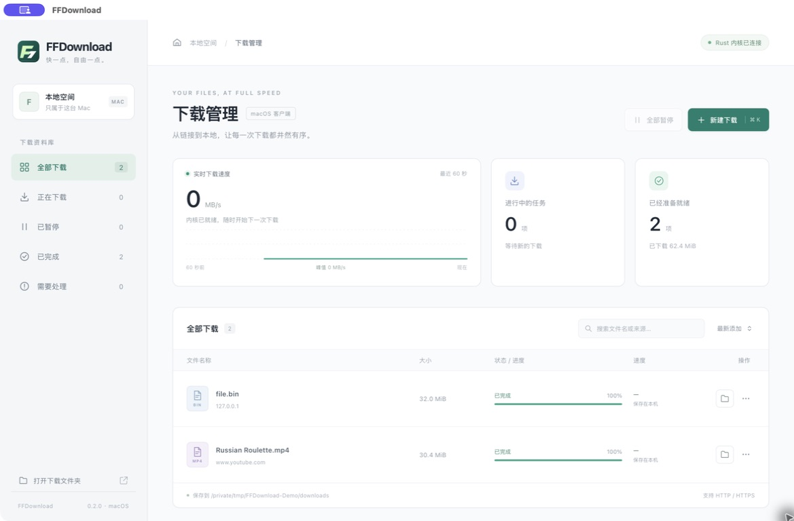

<p align="center"></p>

<h1 align="center">FFDownload</h1>

<p align="center">把下载，交还给你的电脑。基于 Rust 的开源下载管理器，支持 macOS 和 Windows。</p>

<p align="center"><a href="https://ffdownloadmanager.vercel.app">产品官网</a> · <a href="https://github.com/gnipbao/FFDownloadManager/releases">下载安装包</a> · <a href="docs/macos-client.zh-CN.md">macOS 说明</a> · <a href="docs/windows-client.zh-CN.md">Windows 说明</a></p>



## 主要功能

- **大文件下载**：支持 HTTP/HTTPS、1–16 路连接、任务队列、实时速度与进度；下载源不支持分段时自动使用单连接。
- **暂停与续传**：保存下载进度，退出应用后可继续未完成的任务。
- **视频链接解析**：解析部分 YouTube、哔哩哔哩、抖音和小红书公开视频链接，选择可用的格式与清晰度；需要合并音视频时使用内置 FFmpeg。
- **汽水音乐解析**：通过分享页获取网页实际可播放的音频；需要本机安装 Chrome 或 Edge，音质和时长以网页提供的资源为准。
- **本地管理**：文件与任务记录保存在电脑上，无需账号；支持搜索、筛选和在文件管理器中定位文件。
- **下载授权**：HTTPS 文件直链可填写 Cookie 与自定义 Header，例如 `Authorization`、`Referer`、`User-Agent`、`X-API-Key`；支持授权后重试和续传，凭据仅保留在当前应用进程。详见 [授权下载说明](docs/file-download-authorization.zh-CN.md)。

新建下载默认自动识别：HTTP/HTTPS 文件直链直接下载，平台音视频页面先解析。支持压缩包、文档、安装包、音视频及其他文件，也支持无后缀的下载地址；特殊链接可手动选择“文件直链”或“音视频解析”。需要网站登录的文件仍需有效访问授权，浏览器的登录状态不会自动共享给下载器。

桌面界面由 Tauri 承载，下载与视频处理流程以 Rust 为核心。视频解析结果取决于源站的可用性与访问权限。

## 安装

在 [GitHub Releases](https://github.com/gnipbao/FFDownloadManager/releases) 下载对应系统的安装包：

| 系统 | 安装包 | 默认下载目录 |
| --- | --- | --- |
| macOS 13+，Apple Silicon | DMG / ZIP | `~/Downloads/FFDownload` |
| Windows 10/11，x64 | NSIS `.exe` | `%USERPROFILE%\Downloads\FFDownload` |

关闭窗口后任务仍会继续运行；退出应用时会保存进度，下次打开可继续。安装包包含音视频合并组件。当前版本尚未使用发布者证书签名或 Apple 公证，系统可能显示安全提示。

## 从源码构建

需要 [Rust 1.98.1](rust-toolchain.toml)、Node.js 22 和 npm。macOS 还需要 Xcode Command Line Tools：

```sh
npm ci
sh scripts/build-macos.sh
```

Windows 的构建环境与步骤见 [Windows 说明](docs/windows-client.zh-CN.md)。命令行和本地 Web 工作台可通过以下方式启动：

```sh
cargo build --release --locked
./target/release/ffdm serve --port 17890
```

## 可复用的解析模块

源码中的 [ffdm-resolver](crates/ffdm-resolver/README.md) 将平台解析、通用网页媒体识别和格式选择提炼为独立 Rust crate，统一输出下载计划，供 CLI、Web 服务或桌面应用接入。宿主负责下载队列、暂停续传及文件保存，也可注册自己的 Rust 平台适配器。

源码中的解析模块持续增加平台和通用网页、HLS 支持。完整的 [支持平台与下载清单](docs/supported-platforms.zh-CN.md) 列出能力、公开样例和实际验证结果；接口与示例见模块文档，本地验证步骤见 [资源解析说明](docs/resource-resolver.zh-CN.md)。仓库能力与已发布安装包可能不同，安装包以 Release 说明为准。

## 使用声明

本项目的视频链接解析功能仅供技术学习与研究。项目仓库不提供或托管第三方视频；“仅供学习研究”不意味着获得下载、复制或传播这些内容的授权。使用前请确认内容及获取方式均已获得适当授权，并遵守适用法律、版权要求和平台规则，例如 [YouTube 服务条款](https://www.youtube.com/t/terms) 与 [哔哩哔哩用户使用协议](https://www.bilibili.com/blackboard/protocal/licence.html)。请勿用于侵权或绕过平台访问限制；使用者应对自身行为负责。

## 许可证

项目代码采用 [MIT License](LICENSE)。安装包内的 FFmpeg 遵循 LGPL 2.1 或更高版本，相关许可证和源码随安装包提供。
